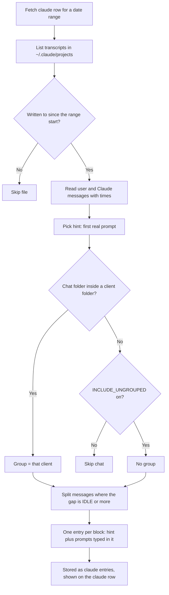

# Claude chats on the timeline

How the `claude` module turns Claude Code chat transcripts into hint entries on
their own timeline row. It reads only local files, picks a client from the chat's
folder, and splits each chat into blocks where messages are close together.
Nothing is billed and no transcript text leaves the machine.

## Colours
- **teal**: reading the transcripts
- **amber**: a choice the module makes
- **blue**: building the entries
- **green**: what the timeline shows
- **rose**: left out

## Boxes
- **List transcripts in ~/.claude/projects**: `Provider.get_chats` in `tracklater/timemodules/claude.py`; the folder is `CLAUDE.global.DIR`.
- **Written to since the range start?**: a file last changed before the range can hold nothing in it, so it is not opened.
- **Read user and Claude messages with times**: `read_chat`; skips bookkeeping lines and subagent (sidechain) messages.
- **Pick hint: first real prompt**: `chat_hint`; an AgentDeck brief shortens to "Work for owner/repo#n", and "Continue the work…" lines are passed over.
- **Chat folder inside a client folder?**: `group_for_cwd`; folders come from `CLAUDE.<group>.DIRS`, or `GIT.<group>.REPOS` when no group sets DIRS. The closest folder wins.
- **INCLUDE_UNGROUPED on?**: off by default, so tooling and side-project chats stay off the row.
- **Split messages where the gap is IDLE or more**: `split_spans`; `CLAUDE.global.IDLE`, default 900 seconds.
- **One entry per block: hint plus prompts typed in it**: `Parser.get_entries`; a lone message lasts `MIN_DURATION` (60 s), and at most `MAX_PROMPTS` (5) prompts are listed.
