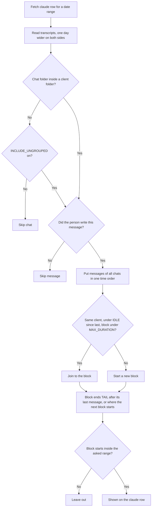

# Claude chats on the timeline

How the `claude` module turns Claude Code chat transcripts into hint entries
on their own timeline row. It shows the moments the person wrote a message, not
how long the agents worked, as one line of short blocks that never overlap.
Nothing is billed and no transcript text leaves the machine.

## Colours
- **teal**: reading the transcripts
- **amber**: a choice the module makes
- **blue**: building the blocks
- **green**: what the timeline shows
- **rose**: left out

## Boxes
- **Read transcripts, one day wider on both sides**: so a block has the same start however the range is cut, and a refetch cannot leave an overlapping copy. Folders come from `CLAUDE.global.DIR`, default `~/.claude*/projects`.
- **Chat folder inside a client folder?**: `group_for_cwd` and `group_dirs` in `tracklater/timemodules/claude.py`; unchanged.
- **INCLUDE_UNGROUPED on?**: off by default, as today.
- **Did the person write this message?**: typed messages, messages sent while the agent worked, and question box answers count. Messages AgentDeck sends by itself, tool results, summaries and subagent lines do not. Words AgentDeck wraps in a note of its own are unwrapped (`unwrap`).
- **Same client, under IDLE since last, block under MAX_DURATION?**: `IDLE` 300 seconds, `MAX_DURATION` 1800 seconds.
- **Block ends TAIL after its last message, or where the next block starts**: `TAIL` 120 seconds; also never past `MAX_DURATION`.
